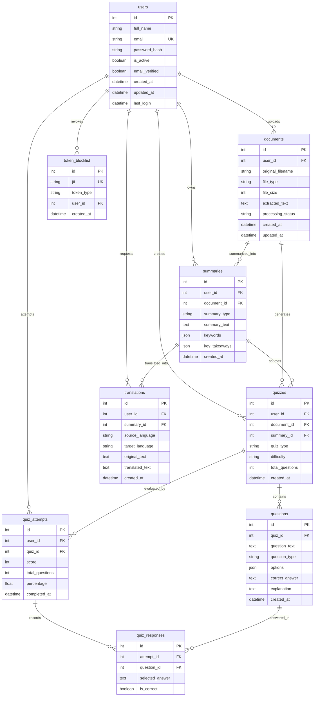
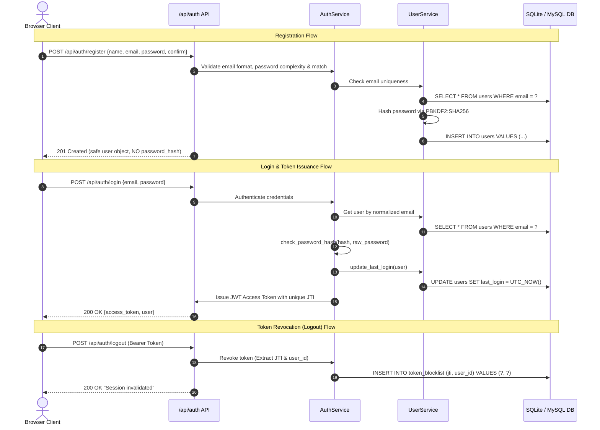

# Database Architecture & Entity-Relationship Specification

**Project:** AI Notes Summarizer with Quiz Generation and Multilingual Translator  
**Phase:** 3 (Database Design and User Authentication)  
**Database Engines:** SQLite (Local Development) / MySQL 8.0+ (Production Ready)  
**ORM Framework:** Flask-SQLAlchemy 3.1+ (SQLAlchemy 2.0 Syntax)  
**Migration Tool:** Flask-Migrate (Alembic)

---

## 1. Entity-Relationship (ER) Diagram

---

## 2. Table Specifications & Data Dictionaries

### 1. `users`
Stores student accounts, credential hashes, and session state.

| Column | Type | Nullable | Constraints / Index | Description |
| :--- | :--- | :--- | :--- | :--- |
| `id` | INTEGER | No | PK, Auto Increment | Unique internal identifier |
| `full_name` | VARCHAR(120) | No | None | Full legal or display name |
| `email` | VARCHAR(255) | No | Unique, Index (`ix_users_email`) | Normalized lowercase email address |
| `password_hash` | VARCHAR(255) | No | None | PBKDF2:SHA256 salted password hash |
| `is_active` | BOOLEAN | No | Default: TRUE | Account operational status |
| `email_verified`| BOOLEAN | No | Default: FALSE | Email verification flag |
| `created_at` | DATETIME | No | Default: UTC Now | Registration timestamp |
| `updated_at` | DATETIME | No | On Update: UTC Now | Last account profile update |
| `last_login` | DATETIME | Yes | None | Timestamp of last successful authentication |

---

### 2. `token_blocklist`
Enforces real JWT revocation for logout and compromised credential invalidation.

| Column | Type | Nullable | Constraints / Index | Description |
| :--- | :--- | :--- | :--- | :--- |
| `id` | INTEGER | No | PK, Auto Increment | Revocation identifier |
| `jti` | VARCHAR(36) | No | Unique, Index (`ix_token_blocklist_jti`) | JWT unique token ID |
| `token_type` | VARCHAR(10) | No | Default: "access" | Token category |
| `user_id` | INTEGER | No | FK `users.id` (ON DELETE CASCADE) | Owning user reference |
| `created_at` | DATETIME | No | Default: UTC Now | Revocation timestamp |

---

### 3. `documents`
Stores original uploaded materials and normalized extracted text.

| Column | Type | Nullable | Constraints / Index | Description |
| :--- | :--- | :--- | :--- | :--- |
| `id` | INTEGER | No | PK, Auto Increment | Document identifier |
| `user_id` | INTEGER | No | FK `users.id` (ON DELETE CASCADE), Index | Tenant isolation ownership |
| `original_filename`| VARCHAR(255)| No | None | Original uploaded file name |
| `file_type` | VARCHAR(30) | No | None | Mime/extension: pdf, docx, txt |
| `file_size` | INTEGER | No | Default: 0 | Size in bytes |
| `extracted_text` | TEXT | No | None | Cleaned, normalized extracted text |
| `processing_status`| VARCHAR(50)| No | Default: "completed" | pending, completed, failed |
| `created_at` | DATETIME | No | Default: UTC Now | Upload timestamp |
| `updated_at` | DATETIME | No | On Update: UTC Now | Last content update |

---

### 4. `summaries`
Stores multi-level AI summaries with extracted keywords and takeaways.

| Column | Type | Nullable | Constraints / Index | Description |
| :--- | :--- | :--- | :--- | :--- |
| `id` | INTEGER | No | PK, Auto Increment | Summary record ID |
| `user_id` | INTEGER | No | FK `users.id` (ON DELETE CASCADE), Index | Tenant isolation |
| `document_id` | INTEGER | No | FK `documents.id` (ON DELETE CASCADE), Index | Originating document |
| `summary_type` | VARCHAR(50) | No | None | short, medium, or detailed |
| `summary_text` | TEXT | No | None | Generated abstractive summary text |
| `keywords` | JSON | Yes | None | Extracted conceptual key terms |
| `key_takeaways`| JSON | Yes | None | High-yield takeaway bullet points |
| `created_at` | DATETIME | No | Default: UTC Now | Generation timestamp |

---

### 5. `quizzes`
Stores assessment configuration sessions.

| Column | Type | Nullable | Constraints / Index | Description |
| :--- | :--- | :--- | :--- | :--- |
| `id` | INTEGER | No | PK, Auto Increment | Quiz session identifier |
| `user_id` | INTEGER | No | FK `users.id` (ON DELETE CASCADE), Index | Owning student |
| `document_id` | INTEGER | Yes | FK `documents.id` (ON DELETE SET NULL), Index | Optional source document |
| `summary_id` | INTEGER | Yes | FK `summaries.id` (ON DELETE SET NULL), Index | Optional source summary |
| `quiz_type` | VARCHAR(50) | No | None | true_false, one_word, mcq, fill_in_blank |
| `difficulty` | VARCHAR(20) | No | Default: "medium" | easy, medium, hard |
| `total_questions`| INTEGER | No | Default: 5 | Total question count |
| `created_at` | DATETIME | No | Default: UTC Now | Synthesis timestamp |

---

### 6. `questions`
Stores individual questions belonging to a quiz.

| Column | Type | Nullable | Constraints / Index | Description |
| :--- | :--- | :--- | :--- | :--- |
| `id` | INTEGER | No | PK, Auto Increment | Question item ID |
| `quiz_id` | INTEGER | No | FK `quizzes.id` (ON DELETE CASCADE), Index | Parent quiz reference |
| `question_text`| TEXT | No | None | Prompt stem or statement |
| `question_type`| VARCHAR(50) | No | None | Question format |
| `options` | JSON | Yes | None | Choice list (MCQ/TF) |
| `correct_answer`| TEXT | No | None | Ground-truth answer |
| `explanation` | TEXT | Yes | None | Educational justification |
| `created_at` | DATETIME | No | Default: UTC Now | Generation timestamp |

---

### 7. `quiz_attempts`
Records user practice attempts and performance analytics.

| Column | Type | Nullable | Constraints / Index | Description |
| :--- | :--- | :--- | :--- | :--- |
| `id` | INTEGER | No | PK, Auto Increment | Attempt transaction ID |
| `user_id` | INTEGER | No | FK `users.id` (ON DELETE CASCADE), Index | Attempting user |
| `quiz_id` | INTEGER | No | FK `quizzes.id` (ON DELETE CASCADE), Index | Evaluated quiz |
| `score` | INTEGER | No | Default: 0 | Number of correct answers |
| `total_questions`| INTEGER | No | None | Total questions presented |
| `percentage` | FLOAT | No | Default: 0.0 | Calculated score percentage |
| `completed_at` | DATETIME | No | Default: UTC Now | Submission completion timestamp |

---

### 8. `quiz_responses`
Stores granular user response choices for each question.

| Column | Type | Nullable | Constraints / Index | Description |
| :--- | :--- | :--- | :--- | :--- |
| `id` | INTEGER | No | PK, Auto Increment | Answer record ID |
| `attempt_id` | INTEGER | No | FK `quiz_attempts.id` (ON DELETE CASCADE), Index | Attempt parent |
| `question_id` | INTEGER | No | FK `questions.id` (ON DELETE CASCADE), Index | Answered question |
| `selected_answer`| TEXT | Yes | None | User's submitted choice |
| `is_correct` | BOOLEAN | No | Default: FALSE | Automated evaluation result |

---

### 9. `translations`
Stores translated summary versions across 9 supported languages.

| Column | Type | Nullable | Constraints / Index | Description |
| :--- | :--- | :--- | :--- | :--- |
| `id` | INTEGER | No | PK, Auto Increment | Translation record ID |
| `user_id` | INTEGER | No | FK `users.id` (ON DELETE CASCADE), Index | Requesting user |
| `summary_id` | INTEGER | No | FK `summaries.id` (ON DELETE CASCADE), Index | Translated summary |
| `source_language`| VARCHAR(50)| No | Default: "en" | Source ISO code |
| `target_language`| VARCHAR(50)| No | None | Target ISO code (ta, hi, te, etc.) |
| `original_text` | TEXT | No | None | Source summary text |
| `translated_text`| TEXT | No | None | Output translated text |
| `created_at` | DATETIME | No | Default: UTC Now | Translation timestamp |

---

## 3. Authentication & Security Data Flow

