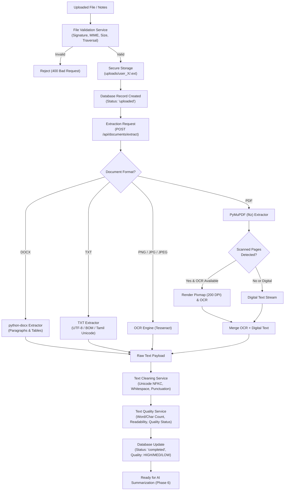

# Document Processing & Text Extraction Architecture (Phase 5)

## AI Notes Summarizer with Quiz Generation and Multilingual Translator

---

## 1. Overview & Pipeline Architecture

The Phase 5 Document Processing and Text Extraction engine ingests educational materials, enforces security validation, routes content to format-specific parsers (PDF, DOCX, TXT, Images), invokes targeted OCR for scanned components, standardizes typography via non-destructive text cleaning, assesses extraction quality, and persists structured records for downstream AI summarization in Phase 6.

### Flowchart: End-to-End Ingestion & Extraction Pipeline



---

## 2. Supported Formats & File Validation

| Format | Extension | MIME Type | Magic Byte Signature | Max Limit |
| :--- | :--- | :--- | :--- | :--- |
| **PDF** | `.pdf` | `application/pdf` | `%PDF` (`\x25\x50\x44\x46`) | 20 MB |
| **Microsoft Word** | `.docx` | `application/vnd.openxmlformats...` | `PK\x03\x04` (OpenXML Zip) | 20 MB |
| **Plain Text** | `.txt` | `text/plain` | Evaluated character encodings | 20 MB |
| **Images** | `.png`, `.jpg`, `.jpeg` | `image/png`, `image/jpeg` | `\x89PNG`, `\xff\xd8\xff` | 20 MB |
| **Direct Text** | N/A | `application/json` | Min. 50 characters | 500 KB |

### Validation Engine Guarantees (`file_validation_service.py`):
1. **Never trusts client filenames**: Sanitizes with `secure_filename` and generates an unguessable UUID-based stored filename (`<uuid4>.ext`).
2. **Path Traversal Prevention**: Rejects `../`, `..\\`, absolute paths, null bytes (`\x00`), and control characters.
3. **Magic Byte Verification**: Verifies actual file content header matches claimed extension to prevent disguised executable uploads.
4. **Empty and Oversized Checks**: Blocks 0-byte uploads and files exceeding `MAX_UPLOAD_SIZE_MB` (default 20MB).
5. **Isolated User Directory**: Uploads are partitioned by authenticated user ID (`uploads/user_<id>/`) outside public static asset folders.

---

## 3. Extractor Implementations

### A. PDF Extraction (`pdf_extractor.py`)
- **Library**: PyMuPDF (`fitz` / `pymupdf`).
- **Layout Preservation**: Extracts blocks (`get_text("blocks")`) to maintain natural paragraph breaks.
- **Scanned Page Detection**: Detects pages with low character counts (<50 characters) that contain image elements (`page.get_images()`). Only those individual pages are flagged for OCR (`pages_needing_ocr`), preventing slow full-document re-rendering.
- **Security**: Detects and rejects password-encrypted PDFs (`doc.is_encrypted`).

### B. Word DOCX Extraction (`docx_extractor.py`)
- **Library**: `python-docx`.
- **Headings & Hierarchy**: Detects heading styles (`Heading 1`, `Heading 2`) and prepends markdown tags (`###`).
- **Table Data Extraction**: Iterates across table rows and cells, collapsing merged duplicates and structuring columns with readable pipe (`|`) delimiters.

### C. Plain Text Extraction (`txt_extractor.py`)
- **Multi-Encoding Fallback**: Evaluates `utf-8-sig` (UTF-8 with BOM), standard `utf-8`, `latin-1`, and `cp1252`.
- **Tamil & Unicode Integrity**: Safely reads multi-byte Unicode scripts without mangling code points.
- **Binary Content Detection**: Rejects binary files containing null bytes.

### D. OCR Processing Engine (`ocr_service.py`)
- **Library**: `pytesseract` + `Pillow`.
- **Preprocessing Pipeline**: Grayscale conversion (`L`), contrast boost (1.8x factor), and edge sharpening.
- **Language Support**: Configurable via `TESSERACT_LANGUAGES` (defaults to `eng+tam`). Falls back gracefully to `eng` if Tamil trained data is absent.
- **Confidence Metrics**: Calculates average token confidence from `image_to_data`.
- **Graceful Host Fallback**: If Tesseract is not installed on the system, the pipeline completes without crashing, returns digital text, and attaches a warning.

---

## 4. Text Cleaning & Quality Assessment

### Text Cleaning Service (`text_cleaning_service.py`)
- **Unicode NFKC Normalization**: Standardizes compatibility characters while preserving all international alphabets.
- **Non-Destructive Whitespace**: Preserves tabs (`\t`), newlines (`\n`), and collapses consecutive space runs.
- **Sentence Boundary Correction**: Cleans punctuation spacing (`word .Next` -> `word. Next`).
- **Preserved Elements**: Mathematical equations (`=`, `+`, `\sqrt`, `\sum`), bullet points (`•`), and list numbers (`1.`, `a.`).

### Text Quality Service (`text_quality_service.py`)
Calculates characters, words, sentences, and paragraphs, assigning an objective rating:
- **`HIGH`**: Word count $\ge 50$, alphanumeric ratio $\ge 50\%$, and OCR confidence $\ge 50\%$.
- **`MEDIUM`**: Word count between 15 and 49 words, or moderate scanning noise.
- **`LOW`**: Word count $< 15$ words or high symbol noise ratio.
- **`FAILED`**: 0 recognizable words or empty content.

---

## 5. REST API Reference

| Method | Endpoint | Description | Auth Required |
| :--- | :--- | :--- | :--- |
| `POST` | `/api/documents/upload` | Upload multipart document (`file` field). Returns document ID and initial status. | Yes (JWT) |
| `POST` | `/api/documents/extract` | Processes document `{ "document_id": 1 }`. Runs extraction, OCR, cleaning & quality scoring. | Yes (JWT) |
| `POST` | `/api/documents/text` | Ingests direct notes `{ "title": "...", "content": "..." }`. | Yes (JWT) |
| `GET` | `/api/documents` | Lists authenticated user's documents with pagination (`?page=1&limit=10&sort=newest`). | Yes (JWT) |
| `GET` | `/api/documents/<id>` | Retrieves complete document details, quality ratings, and extracted text. | Yes (JWT) |
| `DELETE` | `/api/documents/<id>` | Deletes document record and cleans up filesystem storage. | Yes (JWT) |

---

## 6. Installation & OCR Setup Guide

### Python Packages
```bash
pip install PyMuPDF python-docx pytesseract Pillow opencv-python
```

### Tesseract OCR Installation

#### Windows Setup
1. Download the Tesseract installer from UB-Mannheim:
   `https://github.com/UB-Mannheim/tesseract/wiki`
2. Install to default path: `C:\Program Files\Tesseract-OCR\tesseract.exe`.
3. (Optional for Tamil OCR): During installation, check "Additional language data (download)" $\rightarrow$ Select "Tamil", or download `tam.traineddata` from `https://github.com/tesseract-ocr/tessdata` and place it in `C:\Program Files\Tesseract-OCR\tessdata\`.
4. In your `.env` file, specify:
   ```env
   TESSERACT_CMD=C:\Program Files\Tesseract-OCR\tesseract.exe
   TESSERACT_LANGUAGES=eng+tam
   OCR_ENABLED=true
   ```

#### Linux (Ubuntu/Debian) Setup
```bash
sudo apt-get update
sudo apt-get install -y tesseract-ocr tesseract-ocr-tam
```
Configure `.env`:
```env
TESSERACT_CMD=/usr/bin/tesseract
TESSERACT_LANGUAGES=eng+tam
OCR_ENABLED=true
```

---

## 7. Testing & Verification

Run the Phase 5 automated test suite:
```bash
pytest backend/tests/test_file_validation.py backend/tests/test_document_extractors.py backend/tests/test_ocr_and_cleaning.py backend/tests/test_document_api.py -v
```

Run entire project test suite:
```bash
pytest backend/tests -v
```

